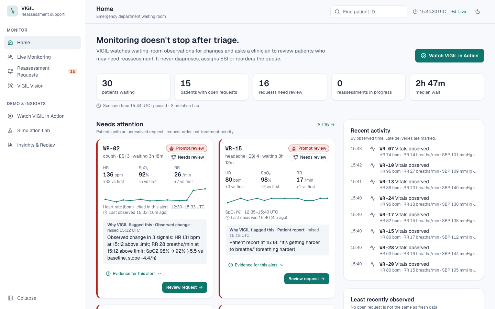
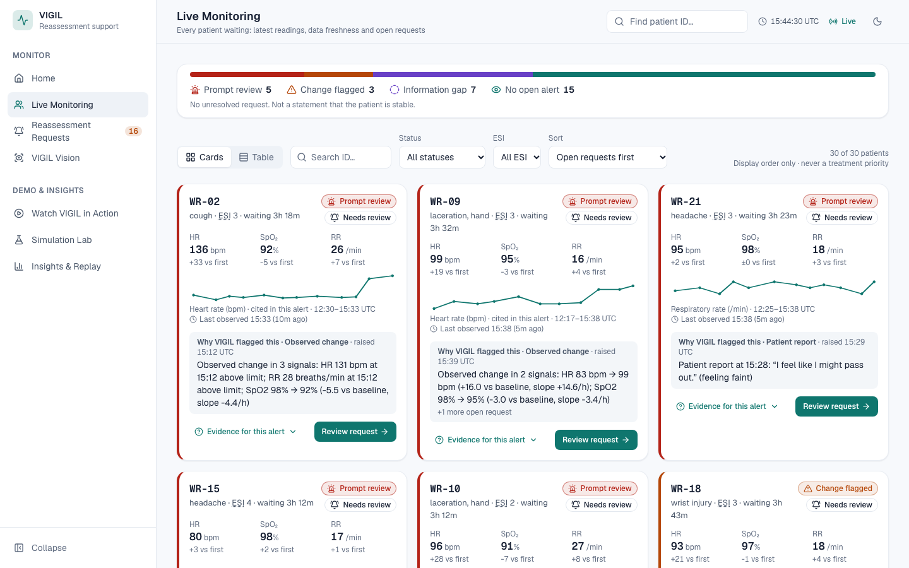
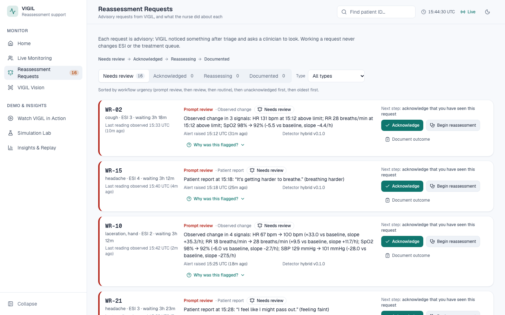
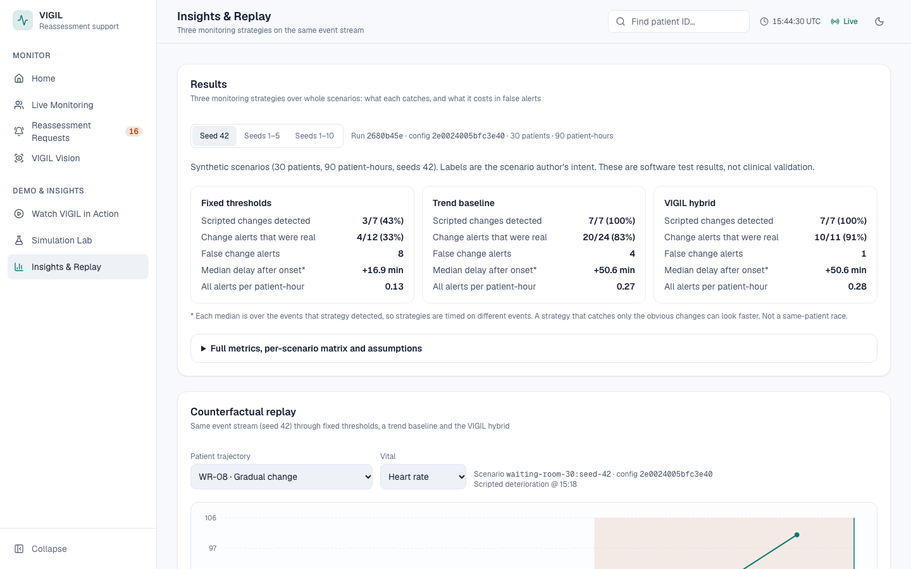

# VIGIL

VIGIL detects **changes after initial triage** and helps clinicians decide which waiting-room
patients may need reassessment. It is not an autonomous triage engine: it never assigns ESI,
diagnoses, or reorders a queue. Every alert is advisory and a nurse makes every decision.

*"Triage captures a moment. VIGIL notices when that picture changes."*



| Live Monitoring | Reassessment Requests | Insights & Replay |
|---|---|---|
|  |  |  |

## Status

| Phase | Scope | State |
|---|---|---|
| 0 | Monorepo, contracts, app boot | ✅ done |
| 1 | Models, migrations, seeded scenarios, ingestion, CRUD, SSE | ✅ done |
| 2 | Nurse console: app shell, Overview, Patient detail (UI spec P0) | ✅ done |
| 3 | Threshold / trend / hybrid detectors; hybrid drives live alerts | ✅ done |
| 4 | Live stream + review workflow integration | ✅ done |
| 5 | Counterfactual replay + evaluation (Insights & Replay screen) | ✅ done |
| C/D | VIGIL Vision: on-device pose, camera sessions bound to a patient, timeline events | ✅ done |
| E | Light theme, new navigation, patient story cards, guided demo, reassessment workflow, explanation seam | ✅ done |
| F | Polish: WCAG AA colour contrast, 12 px minimum text, recovering error states, gzip, lightweight sparklines, local AI explanation drafts, screenshots | ✅ done |
| E.2 | Clarity pass: self-explaining Home, separate observation/workflow status, next-step actions, 7-step demo with nurse review, results summary, late-delivery marking | ✅ done |

## Quick start

Requirements: Python 3.12+ via [uv](https://docs.astral.sh/uv/), Node 20+ and pnpm 9.

```bash
pnpm bootstrap   # pnpm install + uv sync
pnpm dev         # API on :8000, web on :3000
```

Open http://localhost:3000. Screens:
- **Home**: what VIGIL does, who has an open request, recent activity, least-recently-observed patients.
- **Live Monitoring**: every patient as a story card or a table, with observation status and review state shown separately.
- **Reassessment Requests**: acknowledge, begin reassessment, document the outcome; the next step is always the primary button.
- **VIGIL Vision**: an optional camera, linked to a patient by staff.
- **Watch VIGIL in Action**: a guided, reproducible 7-step walkthrough (see [docs/DEMO.md](docs/DEMO.md)).
- **Simulation Lab**: drive the synthetic scenario.
- **Insights & Replay**: results on synthetic scenarios and the counterfactual replay.

On first start the API migrates its SQLite DB
(`services/api/var/vigil.db`) and loads scenario `waiting-room-30` with seed 42: 30 synthetic
patients already waiting, with their triage vitals as history.

Run one uvicorn worker only: the SSE broker is in-process.

**Local AI explanations (optional).** With [Ollama](https://ollama.com) installed, run
`ollama pull qwen3:4b-instruct` once and start with `pnpm dev:llm`. The "What changed" part of
each explanation is then drafted by the local model, checked against the recorded data, and
labelled as an AI draft; anything that fails a check falls back to the rule-based text. Nothing
leaves the machine. See [docs/EXPLANATIONS.md](docs/EXPLANATIONS.md).

**VIGIL Vision** (`/vision`) runs pose estimation in the browser. `pnpm dev` and `pnpm build`
install its assets automatically (MediaPipe WASM from npm, plus the 5.8 MB pose model downloaded
once and checksum-verified into `apps/web/public/models/`). Run `pnpm --filter web vision:setup`
to install them explicitly. After that the camera feature works offline. Use a real browser
window for the camera (localhost is a secure context).

## Checks

```bash
pnpm test              # pytest (API) + vitest (web)
pnpm lint              # ruff + mypy --strict + eslint
pnpm typecheck         # tsc for web and contracts
pnpm contracts:check   # OpenAPI → TS types are up to date
```

## Architecture

```
 Next.js (apps/web) ──REST──▶ FastAPI (services/api) ──▶ SQLite (Alembic migrations)
        ▲                        │  ingest (idempotent) ─▶ events (immutable) ─▶ observations / reports
        └──────── SSE ───────────┤  simulation clock ─▶ scheduled scenario deliveries
                                 └─ hybrid detector ─▶ alerts ─▶ clinician actions ─▶ audit log
```

See [docs/ARCHITECTURE.md](docs/ARCHITECTURE.md), [docs/SAFETY.md](docs/SAFETY.md),
[docs/EVALUATION.md](docs/EVALUATION.md) and [docs/DEMO.md](docs/DEMO.md).

## Repository

```
apps/web/              Next.js nurse console (App Router, TypeScript, Tailwind)
services/api/          FastAPI, Pydantic v2, SQLAlchemy 2, Alembic, pytest
  app/{api,models,schemas,services,simulator,detectors}/
packages/contracts/    OpenAPI document + generated TypeScript types
data/scenarios/        Committed seed-42 fixture (regenerate: pnpm scenario:gen)
docs/                  Architecture, safety, evaluation, demo
```

## API (Phase 1)

| Method | Path | Notes |
|---|---|---|
| GET | `/health` | |
| GET | `/api/patients` | Snapshot; latest value per kind by `observed_at`, `null` = never observed |
| GET | `/api/patients/{id}` | Detail + symptom reports |
| GET | `/api/patients/{id}/timeline` | Observations, reports, alerts, actions sorted by time then id |
| POST | `/api/observations` | 201 created · 200 duplicate · 409 id reused with different payload · 422 invalid |
| POST | `/api/symptom-reports` | Same idempotency rules; `reported_at` defaults to sim clock |
| GET | `/api/alerts?status=&type=&patient_id=` | |
| POST | `/api/alerts/{id}/acknowledge` · `/resolve` | Body `{actor_id, note?}`; demo actors only |
| GET | `/api/audit` | Append-only audit trail |
| POST | `/api/alerts/{id}/begin-reassessment` | Lifecycle: open → acknowledged → reassessment started → resolved (with outcome) |
| GET | `/api/alerts/{id}/explanation` · `/api/patients/{id}/explanation` | Provider-agnostic explanations with citations ([docs/EXPLANATIONS.md](docs/EXPLANATIONS.md)) |
| GET | `/api/patients/series` · `/api/activity` | Sparkline series; recent activity feed |
| GET | `/api/events/stream` | SSE: `hello`, `observation`, `symptom_report`, `alert_updated`, `simulation`, `reset`, `resync` |
| GET | `/api/scenarios`, `/api/simulation` | |
| POST | `/api/simulation/reset` · `start` · `pause` · `step` | Deterministic clock control |

| GET | `/api/replay/catalog?seed=` | Patients and scenario labels for a seed |
| POST | `/api/replay/compare` | One patient's trajectory through all three detectors |
| GET | `/api/evaluation?seeds=1,2,3` | Metrics with denominators; recorded in `detector_runs` |
| POST | `/api/vision/sessions` | Staff bind a camera to a patient; returns a one-time token |
| POST | `/api/vision/events` | Structured camera event (`X-Vision-Token`); no images accepted |
| POST | `/api/vision/sessions/{id}/stop` · GET `…/events` · GET `/api/vision/sessions` | |

Interactive docs: http://localhost:8000/docs. See [docs/EVALUATION.md](docs/EVALUATION.md) for definitions and a held-out snapshot.

## Limitations

- "Ground truth" labels are scenario-author intent.
- No authentication beyond fixed demo actor IDs; no PHI support; single-process server.
- Detector thresholds are hand-picked against the scenario generator. Threshold and trend detectors exist as comparison baselines; only the hybrid runs live.
